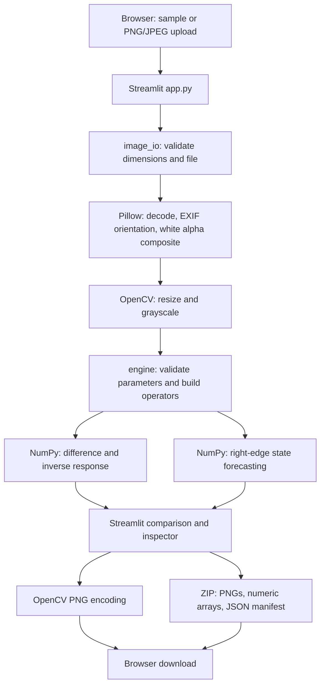

# Architecture and mechanism

## Project purpose

Spatial Matrix Vision Lab turns the supplied matrix-processing prototype into a local interactive website. Its purpose is to make fixed linear spatial operators visible and adjustable: the visitor changes parameters and immediately compares the outputs with the source image.

## Components and data flow



| Layer | Responsibility |
| --- | --- |
| `app.py` | Page layout, image selection, controls, session interaction, result display, inspector and downloads. |
| `spatial_lab/engine.py` | Immutable parameter definitions, matrix construction, stability checks, vectorized transforms and timing. |
| `spatial_lab/image_io.py` | Upload validation, image preparation, deterministic samples and in-memory export packaging. |
| `.streamlit/config.toml` | Website theme, server defaults and upload limit. |
| `tests/` | Independent numerical reference, boundary/validation regressions, image/export checks and app interactions. |

Streamlit serves the browser interface and executes the Python application in the same local server process. The numerical functions do not depend on Streamlit, so another interface or command-line tool can reuse them. There is no separate REST service or database.

## Image preparation

The image pipeline accepts PNG and JPEG bytes, checks the byte limit and actual image type, and inspects dimensions before loading the full image. It rejects source images above 40 million pixels. Pillow applies EXIF orientation and composites transparency onto white. OpenCV resizes the image while preserving its aspect ratio and converts the prepared RGB image to `uint8` grayscale.

The image API accepts a maximum dimension between 128 and 1600 pixels; the website offers 350, 500, 700, 1000, 1400 and 1600. Smaller sources are not enlarged. The engine needs at least three columns because the extension begins with the last three horizontal samples. The source preview, output dimensions and downloaded grayscale source correspond to the prepared processing image.

## State and matrices

Let `p[r,c]` be the grayscale intensity divided by 255. The state used for a pixel is:

```text
X[r,c] = [p[r,c], p[r,c-1], p[r,c-2], noise_floor]ᵀ
```

Missing neighbors at the left edge repeat the first pixel in the row. This provides defined values at every column instead of leaving the first three columns black.

The transition and derived operators are:

```text
    [ φ₁  φ₂  φ₃  θ₁ ]
F = [  1   0   0   0 ]
    [  0   1   0   0 ]
    [  0   0   0   0 ]

D = I - F
J = (I - F)⁻¹
```

The first components of the transformed states become display intensities:

```text
edges[r,c]    = uint8(clip(abs((D X[r,c])[0]) × 255 × edge_gain, 0, 255))
baseline[r,c] = uint8(clip(    (J X[r,c])[0]  × 255 × integration_gain, 0, 255))
```

The gains adjust the visibility of the computed responses. Clipping is part of the display conversion; it can saturate values, so the 8-bit PNGs do not preserve unbounded intermediate values.

## Rightward forecasting

For each row, the initial forecast state uses its last three intensities and a zero residual seed:

```text
S₀ = [p[r,last], p[r,last-1], p[r,last-2], 0]ᵀ
Sₖ = F Sₖ₋₁ = Fᵏ S₀
new_pixel[k] = uint8(clip(Sₖ[0] × 255, 0, 255))
```

The original grayscale columns are copied unchanged into the extension image. Only the requested new columns are forecast. The `theta_1` term has no effect on forecasting when its fourth state component starts at zero and remains zero; it does affect the difference and inverse responses through the nonzero spatial noise seed.

This is deterministic extrapolation from a boundary. Stable states tend toward zero over sufficiently many steps. The calculation has no knowledge of objects, perspective, scene semantics, or missing content.

## Validation and numerical behavior

Parameters must be finite numbers within documented bounds. The engine rejects a transition matrix with spectral radius `ρ(F) ≥ 1`; this protects repeated forecasts from unstable growth. It also rejects an ill-conditioned `I - F` before inversion. The inspector exposes both diagnostics so the calculation remains explainable.

Input arrays must be nonempty, two-dimensional `uint8` grayscale with at least three columns. NumPy computes in double precision. The engine returns three separate `uint8` arrays without modifying the source. The matrices returned in diagnostics are read-only.

The image operators work across all rows and columns as vectorized array expressions. Forecasting loops over the extension width while advancing all rows together. For `H × W` pixels and `K` forecast columns, time is approximately `O(HW + HK)` with a small fixed 4×4 matrix cost. Working memory is proportional to the prepared image size and extension.

## Interactive caching

Streamlit reruns the interface when controls change. To avoid repeating unchanged work, the app keeps bounded in-memory caches for prepared sources, transformations and export bundles, with a 30-minute expiry. Source preparation and transforms each retain at most four entries; bundles retain at most two.

Matrix transforms use a SHA-256 digest of every array byte together with its shape and data type. Export bundle cache keys similarly cover every source/output/matrix array, metadata and parameters. This avoids Streamlit's default sampling of large NumPy arrays incorrectly treating two images with a small pixel change as equivalent.

The ZIP is prepared as ordinary download bytes and reused for the same complete experiment. The displayed computation time is the matrix-engine measurement from the original cached calculation; it excludes image preparation, interface rendering and ZIP encoding. The bundle's creation timestamp also reflects when that cached bundle was first created.

These are process-level Streamlit caches. They are suitable for this local application; a shared deployment needs explicit user isolation and memory-budget decisions.

## Relationship to ARIMA

The blueprint labels the system ARIMA(3,1,1). This application retains its matrix equations and default constants, but the implementation is more precisely a fixed-coefficient spatial state-space demonstration. It does not estimate coefficients from a time series, explicitly difference a series as a statistical ARIMA fitting procedure, or calculate fitted innovations. The inverse matrix is a local linear map on each constructed pixel state; it is not by itself a spatial smoothing filter across the full image.

## Downloads and reproducibility

PNG downloads encode the prepared source or computed output arrays. A ZIP bundle includes these images, a compressed NumPy archive of arrays/matrices, and a JSON manifest describing the source, dimensions and parameters. The archive uses fixed internal file names. Files are constructed in memory and returned through Streamlit's download controls.

All processing occurs in the Python server process. With the default local setup that process runs on this computer. No external inference endpoint, database or third-party upload service is required. A shared deployment would need a separate review of user isolation, caching, authentication and resource limits.
