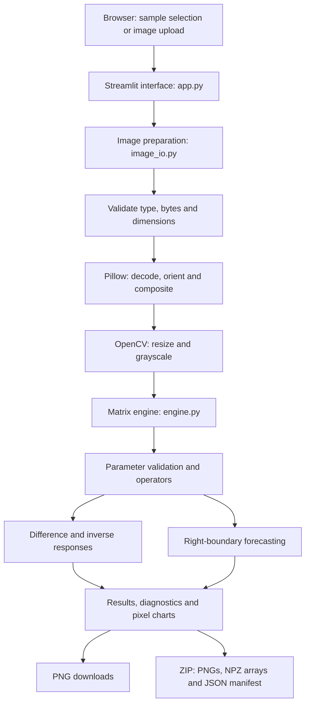
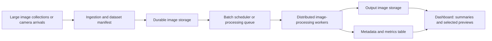

# Spatial Matrix Vision Lab — Complete Project Brief for Report Writing

Prepared on 26 October 2026 from the implemented project, its source files, its existing documentation, and its completed verification results.

This document is a factual source brief for another AI, a student, or a report writer. It describes the current application and separately identifies proposed future work. Do not turn proposed capabilities into claims about the implementation.

## 1. Project identity and recommended title

**Application name:** Spatial Matrix Vision Lab.

**Website heading:** “See what a matrix can do.”

**Recommended academic title:** “Spatial Matrix Vision Lab: Explainable Image Transformation and Boundary Forecasting Using Spatial State-Space Matrices.”

**Alternative title for a big-data course:** “Spatial Matrix Vision Lab: An Image-Processing Prototype and Its Potential Role in Big-Data Image Analytics.”

**Domains:** digital image processing, computer vision experimentation, spatial signal processing, numerical linear algebra, scientific software, and interactive visualization.

**Implementation type:** a local, single-image, CPU-based Python web application. The processing is deterministic and uses fixed user-adjustable coefficients. There is no machine-learning training stage.

The original supplied blueprint used the title “Generative Computer Vision without Neural Networks” and called its equations ARIMA(3,1,1). A report may explain that origin, but should use the more precise implemented description: **ARIMA-inspired spatial state-space transformations**, rather than a fitted statistical ARIMA model or semantic generative AI.

## 2. Abstract suitable for adaptation

Spatial Matrix Vision Lab is an interactive web application that demonstrates image transformations using explicit linear algebra rather than a trained neural network. Users select a procedural sample or upload a PNG/JPEG image. The application validates and prepares the image, converts it to grayscale, and represents each pixel using a four-dimensional state consisting of its intensity, two horizontal neighbours, and a constant noise seed. A transition matrix and its derived difference and inverse operators generate a directional difference response and an intensity-remapping response. Repeated state transitions extend the right boundary of the image with predicted grayscale values. The interface provides adjustable parameters, matrix inspection, numerical stability checks, pixel-response charts, and downloadable experiment data. Streamlit provides the interface, NumPy performs the numerical operations, OpenCV handles image conversion and encoding, and Pillow handles decoding and orientation. The implementation is a bounded local prototype. It can illustrate a reusable processing component for a future distributed image-analytics pipeline, but it does not currently implement big-data storage, distributed execution, or streaming ingestion. Its verification establishes numerical and functional correctness against the specified equations, rather than semantic reconstruction quality or large-scale analytical performance.

## 3. Problem statement and motivation

The engineering problem is to turn a short mathematical image-processing prototype into a usable, inspectable, and reproducible website.

An image can be represented as a grid of numerical intensities. Neighbouring pixels often have related values. This project explores how simple local states and a small transition matrix respond to those relationships. It makes each operator visible so that a user can connect a coefficient change to an output image and an equation.

The motivation is educational and experimental: demonstrate non-neural image processing, make matrix dynamics understandable, and provide a working interface around a numerical engine. The project does not establish that these particular operators are superior to established edge detectors, denoisers, statistical forecasting methods, or neural image-generation systems.

## 4. Objectives

1. Implement the supplied transition, difference, inverse, and forecasting equations.
2. Accept real PNG/JPEG image files with understandable validation errors.
3. Provide three image outputs from the same grayscale source.
4. Allow interactive exploration of coefficients, gains, resolution, and forecast width.
5. Reject unstable or numerically unreliable parameter configurations.
6. Separate image preparation, numerical computation, and presentation into reusable modules.
7. Export the images, operator matrices, and experiment settings.
8. Verify the optimized implementation against independent reference calculations.
9. Explain the connection to large image datasets without claiming distributed capabilities that are absent.

## 5. What is implemented and what is not

| Area | Implemented now | Not implemented |
| --- | --- | --- |
| Workload | One selected image per interactive experiment | Dataset-wide batch processing or an ingestion stream |
| Processing | NumPy/OpenCV on the local CPU | GPU execution or a distributed compute cluster |
| Model | Explicit four-dimensional matrices and fixed coefficients | Training, fitted ARIMA, learned innovations, or confidence intervals |
| Image effects | Directional difference, inverse response, rightward forecast | Object detection, semantic segmentation, arbitrary-hole inpainting |
| Storage | Temporary server memory and user downloads | Persistent image repository, database, or data lake |
| Interface | Local Streamlit website | A separate public business REST API or mobile application |
| Deployment | Verified Windows virtual-environment workflow | Verified public hosting, production load deployment, or verified Docker execution |
| Access | Localhost server | Authentication, authorization, or multi-user cache isolation |
| Big data | Reusable numerical component and an architectural opportunity | Spark, Hadoop, Kafka, distributed storage, or cluster benchmarks |

ZIP, NPZ, and PNG use existing file-format compression; this is not a new image-compression algorithm or a compression study.

## 6. Technologies and verified environment

| Technology | Verified version | Responsibility |
| --- | --- | --- |
| Python | 3.12.14 | Application language and server runtime |
| Streamlit | 1.66.1 | Browser interface, widgets, reruns, caching, downloads |
| NumPy | 2.5.4 | Array operations, matrix algebra, diagnostics, NPZ export |
| opencv-python-headless | 4.14.0.94 | Resizing, RGB/grayscale conversion, PNG encoding, procedural drawing |
| Pillow | 12.3.0 | Image decoding, header inspection, EXIF orientation, alpha handling |
| pytest | 9.1.1 | Development test runner |

The current pinned NumPy version requires **Python 3.12 or later**. Python 3.12 is the recommended reproduction environment because that version was actually tested.

`requirements.txt` pins the four direct runtime packages. `requirements-dev.txt` adds pytest. `requirements-lock.txt` records the complete tested dependency environment. The application requires no API key, external inference endpoint, GPU, account, or model download.

## 7. Architecture

The application is a modular local client-server application. Streamlit serves the website and executes the Python computation in the same server process. The image and numerical modules are ordinary Python modules and do not depend on the browser interface.



There are three logical responsibilities: presentation, image preparation/export, and numerical processing. They are not independently deployed microservices. No database is needed for the current workflow.

## 8. Project files

```text
app.py                         Streamlit page, widgets, callbacks and caches
spatial_lab/
  __init__.py                  Package entry point
  engine.py                    Parameters, matrices, transformations, diagnostics
  image_io.py                  Decoding, validation, samples, PNG and ZIP export
tests/
  test_engine.py               Numerical correctness and parameter validation
  test_image_io.py             Image preparation and export verification
  test_app.py                  Streamlit interaction and upload tests
docs/
  ARCHITECTURE.md              Existing architecture and mechanism guide
  PROJECT_GUIDE.md             Website walkthrough and troubleshooting
  PROJECT_REPORT_BRIEF.md      This complete report source brief
  AI_REPORT_PROMPT.txt         Prompt to use with this brief in another AI
  website-preview.png         Saved website preview
.streamlit/config.toml         Theme, localhost address, port and upload settings
requirements.txt              Pinned direct runtime dependencies
requirements-dev.txt          Development dependencies
requirements-lock.txt         Complete tested dependency snapshot
pytest.ini                    Test discovery configuration
setup.bat                     Windows setup entry point
scripts/setup.ps1             Python discovery, virtual environment and installation
run.bat                       Windows website launcher
Dockerfile                    Optional container configuration
.dockerignore / .gitignore    Generated-file and secret exclusions
README.md                     Main setup and usage instructions
```

The ignored `artifacts/` folder may contain local server logs, a process identifier, and verification screenshots. These operational artifacts are different from the app deliberately persisting user uploads; uploads and generated download payloads are constructed in memory.

## 9. End-to-end image workflow

1. The user chooses **Sample gallery** or **Upload image**.
2. The user selects a processing resolution and matrix parameters.
3. The app constructs the operators and checks numerical validity.
4. The image pipeline checks the uploaded bytes and actual format.
5. It reads dimensions before full pixel decoding and rejects excessive source size.
6. Pillow loads the image and applies EXIF orientation.
7. Transparency is placed on a white background. Sixteen-bit grayscale PNG intensities are scaled into eight-bit intensities.
8. OpenCV downsizes the RGB image, preserving aspect ratio without enlarging small images.
9. OpenCV converts the prepared RGB image to grayscale.
10. The numerical engine converts grayscale intensities into floating-point values in `[0,1]`.
11. It constructs horizontal pixel states, applies the difference and inverse operators, and calculates the rightward forecast.
12. Responses are gained, clipped, and converted to eight-bit grayscale arrays.
13. The website displays the prepared source, the outputs, diagnostics, and optional pixel charts.
14. The user can export an output PNG or the full experiment ZIP.

The preview and processing source use the same prepared dimensions. Reported original dimensions are measured after EXIF orientation. Exported `source.png` is the prepared RGB source, not the original file bytes or necessarily the original resolution.

## 10. Mathematical notation

Let:

- `H` = prepared image height in rows.
- `W` = prepared image width in columns.
- `K` = number of forecast columns.
- `gray[r,c]` = eight-bit grayscale input at row `r`, column `c`.
- `p[r,c] = gray[r,c] / 255` = normalized intensity.
- `epsilon` = the fixed spatial noise seed.
- `I` = the 4 by 4 identity matrix.
- `e1` = the vector selecting the first state component.

The spatial index is the **pixel column**, rather than elapsed time. Each row is processed independently.

### 10.1 Pixel state

```text
X[r,c] = [p[r,c], p[r,c-1], p[r,c-2], epsilon]^T
```

At the true left image boundary, missing neighbours repeat the first pixel. At column zero both lags repeat it; at column one the second lag repeats it. This processes every column and avoids the supplied prototype's unprocessed black band.

For the two response images, each state is constructed from the source pixels. The engine does not recursively feed its displayed edge or inverse outputs back into the next source-pixel state.

### 10.2 Transition and derived matrices

```text
    [ phi_1  phi_2  phi_3  theta_1 ]
F = [   1      0      0       0    ]
    [   0      1      0       0    ]
    [   0      0      0       0    ]

D = I - F
J = inverse(I - F)
```

The first row of each derived operator is sufficient to calculate the displayed response, although the full matrices are retained for inspection and export.

### 10.3 Default parameters

| Parameter | Default | Meaning |
| --- | --- | --- |
| `phi_1` | 0.55 | First transition coefficient |
| `phi_2` | 0.25 | Second transition coefficient |
| `phi_3` | 0.10 | Third transition coefficient |
| `theta_1` | -0.40 | Weight of the fourth state component |
| `noise_floor` | 0.02 | Constant fourth component in per-pixel states |
| `edge_gain` | 4.0 | Difference response visibility gain |
| `integration_gain` | 0.15 | Inverse response visibility gain |
| `extension_px` | 40 | Number of predicted columns |
| Processing resolution | 700 | Longest-side cap used by the initial website view |

The noise seed is a constant input. It is not a fitted residual, a measured sensor-noise level, or a new random innovation at every pixel.

### 10.4 Exact default operators

```text
F = [ 0.55  0.25  0.10 -0.40 ]
    [ 1     0     0     0    ]
    [ 0     1     0     0    ]
    [ 0     0     0     0    ]

D = [ 0.45 -0.25 -0.10  0.40 ]
    [-1     1     0     0    ]
    [ 0    -1     1     0    ]
    [ 0     0     0     1    ]

J = [10     3.5   1    -4    ]
    [10     4.5   1    -4    ]
    [10     4.5   2    -4    ]
    [ 0     0     0     1    ]
```

Small floating-point representation differences are normal; the inspector rounds displayed entries to four decimals.

## 11. The three outputs and their correct interpretation

### 11.1 Directional detail: difference response

```text
raw_difference[r,c] = abs(e1^T D X[r,c])
edges[r,c] = uint8(clip(255 * edge_gain * raw_difference[r,c], 0, 255))
```

With the defaults:

```text
raw_difference = abs(0.45*p[c] - 0.25*p[c-1] - 0.10*p[c-2] + 0.008)
```

This response can emphasize changes along a row. It is not an ideal derivative or a validated general edge detector. For a constant eight-bit intensity `b`, the default output is approximately:

```text
floor(0.4*b + 8.16)
```

Thus constant black produces about 8 and constant white about 110. The method does not eliminate all constant background intensity. It uses horizontal neighbourhoods only, so it does not directly compare pixels between adjacent rows.

### 11.2 Intensity baseline: inverse-operator response

```text
raw_inverse[r,c] = e1^T J X[r,c]
baseline[r,c] = uint8(clip(255 * integration_gain * raw_inverse[r,c], 0, 255))
```

With the defaults:

```text
raw_inverse = 10*p[c] + 3.5*p[c-1] + p[c-2] - 0.08
```

This is a local intensity remapping through the inverse matrix. The word “integration” refers to the chosen algebraic operator. The code does not perform a general two-dimensional cumulative integral or demonstrate recovery of true illumination.

For a constant eight-bit intensity `b`, the default displayed response is approximately:

```text
floor(clip(2.175*b - 3.06, 0, 255))
```

Constant intensities of 119 and above saturate to white at the default gain. The report must not claim proven denoising, smoothing, or illumination restoration without additional experiments and appropriate reference data.

### 11.3 Spatial forecast: right-boundary extrapolation

The seed uses the last three normalized source pixels in each row:

```text
S0 = [p[r,W-1], p[r,W-2], p[r,W-3], 0]^T
Sk = F * S(k-1) = F^k * S0
new_pixel[k] = uint8(clip(255 * Sk[0], 0, 255))
```

The output has shape `H by (W+K)`. Its first `W` columns are copied byte-for-byte from the prepared grayscale source. The new columns are added on the right, not below the image and not inside arbitrary holes.

Because the fourth forecast-state component starts at zero and remains zero, **changing `theta_1` or `noise_floor` does not change this forecast**. The forecast is effectively an AR(3)-style intensity recurrence with no new random innovations. It uses floating-point forecast states internally; quantized display pixels are not fed back into the recurrence.

Stable forecasts tend to zero over sufficiently many steps. Individual predicted values need not fall monotonically. There is no object, texture, perspective, or scene-understanding model, and no semantic inpainting.

### 11.4 Small verified example

For the one-row grayscale image `[100,150,200]`, default coefficients and gains, and a five-column extension, the installed implementation produces:

```text
Input:       [100,150,200]
Detail:      [48,138,178]
Baseline:    [214,255,255]
Extension:   [100,150,200,157,151,142,132,123]
```

This is an explanatory numerical example, not a quality benchmark. The matrix operations themselves are linear; absolute value, clipping, and integer quantization make the complete displayed pipeline not entirely linear.

## 12. Relationship to statistical ARIMA

Statistical ARIMA uses autoregressive order `p`, differencing order `d`, and moving-average order `q`. The supplied blueprint borrowed that terminology, but the implemented application does not fit such a model. The official statsmodels description is a useful reference for the meaning of those orders. [ARIMA reference](https://www.statsmodels.org/stable/_modules/statsmodels/tsa/arima/model.html)

In this project:

- Coefficients are manually selected, rather than estimated from an observed series.
- No fitted differenced-series model is constructed.
- No moving-average innovations are estimated from model residuals.
- No likelihood optimization, uncertainty intervals, or statistical model-selection process is present.
- Applying `I-F` to the constructed state is not the same as implementing the `d=1` part of a complete ARIMA(3,1,1) model.

Suitable wording is “a deterministic spatial state-space demonstration inspired by an ARIMA-labelled blueprint.” No statsmodels dependency is installed or used by the application; the linked documentation is explanatory background.

## 13. Numerical validation and stability

Parameters must be finite real numbers in their allowed bounds. Boolean values are rejected as numeric coefficients; forecast width must be an integer.

The engine computes the spectral radius, the largest absolute eigenvalue of `F`, and requires:

```text
rho(F) < 1
```

It also requires the condition number of `I-F` not to exceed `100,000,000` and handles matrix-inversion failure.

At the defaults:

```text
rho(F) = 0.9328896659540811
condition_number(I-F) = 35.69593630224798
```

With the supported nonnegative phi bounds, keeping their sum below one gives the relevant stable region. The code's actual acceptance test uses the spectral radius and condition number. Stability is a numerical-dynamics property; it does not guarantee useful image semantics or image quality.

## 14. Website controls and features

The website has three tabs: **Workspace**, **Matrix inspector**, and **How it works**.

The Workspace displays source selection, the source preview, result cards, processing dimensions, matrix-engine time, extension width, spectral radius, PNG downloads, the experiment ZIP, and an expandable grayscale comparison with a row-response chart.

The Matrix inspector displays all three matrices, equations, numerical diagnostics, and current parameters as JSON. The How it works tab explains the preparation pipeline, the meaning of each response, and the limitations.

### 14.1 Exact ranges

| Setting | Website | Numerical engine/image API |
| --- | --- | --- |
| Each phi coefficient | 0 to 1, step 0.01 | 0 to 1 |
| Theta coefficient | -1 to 1, step 0.01 | -1 to 1 |
| Extension columns | 0 to 256, step 1 | Integer 0 to 256 |
| Difference gain | 0 to 12, step 0.25 | 0 to 32 |
| Inverse gain | 0 to 2, step 0.01 | 0 to 8 |
| Noise seed | 0 to 0.20, step 0.005 | 0 to 1 |
| Longest-side cap | 350, 500, 700, 1000, 1400, 1600 | Integer 128 to 1600 |

The sidebar's API-independent controls are intentionally narrower than some engine bounds. The matrix checks can reject a combination even when every slider is individually in range.

### 14.2 Presets

- **Blueprint defaults:** the defaults described above.
- **Gentle response:** phi values `0.40,0.20,0.10`, difference gain `2`, inverse gain `0.30`, with remaining defaults.
- **Strong outlines:** phi values `0.60,0.20,0.10`, difference gain `7`, with remaining defaults.

Presets populate the controls; users can then edit individual values. Reset restores the blueprint parameters and the 700-pixel processing cap.

### 14.3 Samples

The three samples are **Coastal architecture**, **Geometric study**, and **Light & texture**. They are deterministic procedural images generated in code at 1000 by 650 pixels before preparation. They are not a collected research dataset, a training dataset, or three externally downloaded photographs.

The default sample is resized to 700 by 455 pixels. A one-row image is supported when it is at least three pixels wide; row selection is omitted when only one row exists.

## 15. Input handling and resource limits

- Supported formats: still PNG and JPEG, checked by magic bytes and decoded format.
- Maximum file size: `15 * 1024 * 1024` bytes, or 15 MiB.
- Maximum source size: 40,000,000 pixels.
- Width must be at least three pixels after orientation and after any resize.
- The source is inspected before full decode to reject oversized dimensions early.
- Empty, unsupported, corrupt, animated, or excessive inputs receive readable errors.
- EXIF orientation is applied.
- Transparent regions are composited onto white.
- Sixteen-bit grayscale PNG values are mapped from `[0,65535]` into `[0,255]` with rounding.
- Resizing uses OpenCV `INTER_AREA`, preserves aspect ratio, and does not upscale small inputs.
- The engine accepts nonempty two-dimensional `uint8` arrays; it calculates with `float64` and returns `uint8` images.

These are application input checks and resource limits, not evidence of a comprehensive security audit.

## 16. Main Python interfaces

### Numerical module: `spatial_lab/engine.py`

`EngineParameters` is a frozen dataclass with `phi_1`, `phi_2`, `phi_3`, `theta_1`, `noise_floor`, `edge_gain`, `integration_gain`, and `extension_px`.

`Operators` contains `transition`, `difference`, `integration`, `spectral_radius`, and `condition_number`.

`TransformResult` contains `edges`, `baseline`, `extension`, `elapsed_ms`, and `operators`.

Public operations:

```python
build_operators(params=EngineParameters()) -> Operators
process_image(gray, params=EngineParameters()) -> TransformResult
process_spatial_matrix_image(gray) -> tuple_of_three_images
```

The last function preserves the blueprint's three-image calling pattern. The operator arrays are marked read-only by the builder. A frozen dataclass does not by itself make every contained output array immutable.

### Image module: `spatial_lab/image_io.py`

`PreparedImage` contains prepared `rgb`, `gray`, oriented source dimensions, a sanitized source name, and a resize flag, with width/height properties.

Public operations:

```python
decode_image(data, source_name, max_dimension=700) -> PreparedImage
demo_image(name, max_dimension=700) -> PreparedImage
encode_png(image) -> bytes
build_download_bundle(prepared, result, params) -> bytes
```

`ImageValidationError` subclasses `ValueError` for readable input/export errors.

For example, another Python application can use the numerical component without Streamlit:

```python
from spatial_lab.engine import EngineParameters, process_image
from spatial_lab.image_io import demo_image

prepared = demo_image("Geometric study", max_dimension=700)
result = process_image(prepared.gray, EngineParameters(extension_px=80))
print(result.edges.shape, result.extension.shape)
```

## 17. Downloads and experiment data

Individual downloads provide three output PNGs and the grayscale input PNG.

The experiment ZIP contains:

| File | Contents |
| --- | --- |
| `source.png` | Orientation-corrected RGB source at processing resolution |
| `grayscale.png` | The exact prepared grayscale input |
| `edges.png` | Gained and clipped difference response |
| `baseline.png` | Gained and clipped inverse response |
| `extension.png` | Prepared grayscale source plus forecast columns |
| `matrices.npz` | Source/output arrays and full floating-point operator matrices |
| `manifest.json` | Parameters, dimensions, diagnostics, timing, boundary policy and explanatory notes |

The NPZ keys are `source_rgb`, `grayscale`, `edges`, `baseline`, `extension`, `transition`, `difference`, and `integration`. NumPy can load them with `allow_pickle=False`.

The manifest also includes an application name, format version, UTC creation time, source name, and statements describing the prepared source and the model's limitations.

The archive does **not** separately preserve the original encoded upload, the source before preparation/resizing, original EXIF metadata, normalized per-pixel states, unbounded intermediate responses, code version, dependency versions, or input checksums. If no resize is needed, the prepared source can have the same dimensions as the oriented original. The response image arrays inside NPZ are already gained/clipped eight-bit results. It supports repeating the mathematical experiment from the prepared data; it is not a complete software-environment archival format.

## 18. Performance, complexity, caching and privacy

For prepared height `H`, width `W`, and extension `K`:

```text
Numerical time complexity: O(HW + HK)
Numerical working memory: O(HW + HK)
```

The matrices are only 4 by 4. NumPy evaluates the response expressions over whole arrays. The extension loops over `K` columns while updating all rows together. This avoids a Python loop at every source pixel, but vectorization does not mean that work is distributed across computers.

The current input path still fully decodes its bounded source image and holds prepared arrays in memory. It is not a true incremental file-streaming or out-of-core large-image implementation.

Upload preparation, sample preparation, and transformations each have a separate maximum-four-entry Streamlit cache with a 30-minute expiry. The ZIP cache holds at most two entries with the same expiry. Generated sample bytes also use a three-entry Python `lru_cache`.

Transform cache keys include a SHA-256 digest of every image byte, its shape, and its type. Export cache keys include every source/output/operator array and relevant experiment metadata. This avoids relying on sampled hashing for large arrays. SHA-256 here identifies cache inputs; it is not image encryption or an access-control mechanism.

The displayed compute time measures the numerical engine only and may be the original time of a cached result. It excludes decoding, resizing, chart rendering, and export preparation. A cached ZIP may also reuse its original creation timestamp. Neither value is a distributed benchmark or a guarantee of full-page latency.

The app does not deliberately write uploads or outputs to disk or send them to external inference services. Downloading does not clear server copies. Cached/session data can remain in memory after a download until applicable expiry, eviction, session cleanup, or server shutdown; cache TTL is not a guarantee that every copy is deleted after 30 minutes. The default server listens on `127.0.0.1:8501`, and Streamlit usage telemetry is disabled. The caches are process-level rather than isolated per user; a shared deployment would require explicit user isolation, resource limits, authentication, and data-lifecycle design.

## 19. Verification and evidence

The last completed full suite passed **63 test cases**:

| Area | Cases | Evidence covered |
| --- | ---: | --- |
| Numerical engine | 30 | Independent pixel-loop and matrix-power comparisons, bounds, stability, shapes, boundaries, determinism and source preservation |
| Image pipeline and export | 24 | PNG/JPEG correctness, orientation, transparency, 16-bit conversion, limits, samples and archive contents |
| Streamlit workflow | 9 | Initial sample, sample changes, real uploads, clearing/replacing images, corrupt-input recovery, controls, presets and reset |

The last full run completed in approximately 7.98 seconds in the development environment. That is a test-suite runtime, not an image-throughput benchmark. The reference comparisons allow at most one eight-bit intensity level where floating-point evaluation order changes quantization.

Manual verification also confirmed website rendering, localhost health, the launcher, and PNG/ZIP controls. An actual browser check exposed a deferred-ZIP session issue, so the final implementation uses ordinary cached download bytes. Non-failing warnings came from upstream Streamlit/Pandas deprecations.

These tests establish implementation behavior. They do not establish scientific accuracy, reconstruction quality, noise reduction, superiority over neural networks, distributed speedup, production load capacity, or a complete security assessment. Docker configuration exists but container execution has not been verified.

## 20. How this project relates to big data

### 20.1 Accurate current classification

The current application is a **local image-processing prototype with potential as a component of a larger image-data pipeline**. It is not currently a distributed big-data platform.

NIST describes big data in terms of extensive datasets and characteristics such as volume, variety, velocity, and variability that call for scalable storage and analysis architecture. Many pixels in one photograph, or use of a matrix, does not alone establish that an application is a big-data system. [NIST big-data overview](https://csrc.nist.gov/topics/technologies/big-data)

The real relationship is that large image collections need ingestion, validation, normalization, transformation, metadata, storage, and analysis. This project implements a small, inspectable transformation stage and a local exploration interface. Its independent image/row calculations offer useful future parallel-processing boundaries.

### 20.2 Common five-V interpretation

| Big-data lens | Connection to this project | Current implementation and future need |
| --- | --- | --- |
| Volume | A future workload might contain millions of images | Current UI handles one bounded image; a collection would need durable storage and batch execution |
| Velocity | Cameras could generate images continuously | Current uploads are user-triggered; a stream would need ingestion, buffering and capacity management |
| Variety | Images differ in format, channels, orientation and bit depth | PNG/JPEG preparation is implemented; video, multispectral and additional formats are not |
| Veracity | Invalid data, missing metadata and misleading interpretation affect trust | Validation and numerical tests exist; content accuracy and dataset provenance require more work |
| Value | Explainable processing can support education or an analytical preprocessing stage | Educational utility is demonstrated; operational/domain value needs a defined use case and evaluation |

Workload **variability** is another useful lens: image sizes, decoding costs, arrival rates, and content differ, so future scheduling should account for uneven jobs. Do not claim that the current system has demonstrated all big-data characteristics at scale.

### 20.3 Relevance of each implemented component

- Validation resembles the data-quality stage of a larger ingestion pipeline.
- Grayscale conversion and resizing standardize heterogeneous inputs for a defined operation.
- The numerical module can serve as a worker-side image-transformation function.
- Exported parameters and diagnostics provide a starting point for experiment metadata.
- Bounded caches and processing caps demonstrate resource awareness on one machine.
- The dashboard can illustrate an experiment interface, while a future large system would display job summaries and selected examples rather than all images.

These are architectural connections, not evidence of Hadoop, Spark, a data lake, or real-time processing in the present code.

## 21. Proposed big-data architecture — future work only



This is a proposed design derived from the current module boundaries. No component in this diagram beyond the local processing functions and local dashboard has been implemented as a distributed service.

### 21.1 A possible Spark batch design

The initial distributed unit of work should normally be a complete image, rather than an individual pixel. Spark's binary-file source can represent a file as a record containing its content and metadata. Its distributed map/partition operations could run the existing decoder and engine inside workers, with compatible Python/native packages installed on each worker. [Spark binary-file source](https://spark.apache.org/docs/latest/sql-data-sources-binaryFile.html), [Spark programming guide](https://spark.apache.org/docs/latest/rdd-programming-guide.html)

A future implementation would add dataset manifests, versioned parameters, job IDs, worker retries, deduplication, output references, and metrics. Large outputs should be stored in durable storage; the dashboard should load summaries and a bounded set of previews. Collecting a whole large image collection into one driver would defeat the memory distribution. This is a design recommendation, supported by Spark's documented warning about collecting data onto one machine. [Spark programming guide](https://spark.apache.org/docs/latest/rdd-programming-guide.html)

HDFS is one possible storage technology with distributed blocks and configurable replication; object storage is another possible design choice. Neither is included in the project. [HDFS architecture](https://hadoop.apache.org/docs/current/hadoop-project-dist/hadoop-hdfs/HdfsDesign.html)

A genuine streaming requirement could be explored with a stream-processing framework such as Spark Structured Streaming, but it would require actual ingestion, checkpointing, output handling, and failure tests. A Streamlit widget rerun is not a streaming data pipeline. [Structured Streaming overview](https://spark.apache.org/docs/latest/streaming/index.html)

### 21.2 Partitioning details that matter

1. Different images can be processed independently under the same parameter configuration.
2. Rows within one image are independent because no vertical neighbours are used.
3. Splitting an image into column tiles requires two real left-neighbour pixels as an overlap, or halo, for the local response calculations.
4. Repeating the first pixel of every tile would create incorrect internal boundaries. Replication applies only at the image's true left edge.
5. Forecasting belongs at the true right boundary and must use that row's last three real source pixels.
6. Forecast columns are recursively dependent along their extension direction.
7. Very large source tiling needs a new input and assembly path; the present decoder reads a bounded whole image.

Adding workers can increase processing capacity. It does not make this fixed forecast understand objects or improve its mathematical quality automatically.

### 21.3 Hypothetical scale example

Suppose a future dataset contains one million prepared grayscale images, each 700 by 700 pixels at one byte per pixel:

```text
Per-image grayscale bytes = 700 * 700 = 490,000
Dataset grayscale bytes = 1,000,000 * 490,000
                        = 490,000,000,000 bytes
                        = 490 GB using decimal units
```

This counts the grayscale input arrays only. RGB sources, response images, extensions, metadata, replicas, and backups add storage. Actual PNG/JPEG/NPZ file sizes depend on compression and content. These figures are arithmetic for an assumed future dataset, not a dataset processed or stored by this application.

### 21.4 What must be measured before claiming big-data success

- Images/second and megapixels/second at stated resolutions and worker counts.
- End-to-end latency percentiles, separating ingestion, decode, compute and output.
- Peak worker memory, storage per image, network traffic and queue delay.
- Parallel speedup and efficiency on the same workload.
- Failure, retry, duplicate-output and recovery behavior.
- Numerical equivalence with the current reference tests, including tile boundaries.
- Actual image-quality measures using appropriate reference data.

None of these dataset-scale results has been measured in the current project.

## 22. Limitations and defensible future improvements

### Current limitations

- Single selected image and bounded in-memory processing.
- Horizontal local structure only; no vertical or semantic analysis.
- Fixed manually selected coefficients.
- Nonzero response to uniform images in the difference view.
- Possible strong clipping and loss of detail in the inverse view.
- Forecast fading under stable dynamics; no arbitrary missing-region repair.
- No training dataset, benchmark dataset, or domain-quality evaluation.
- No durable experiment catalog, background job system, or distributed processing.
- No public-deployment authentication or user-isolated caching.
- Exports omit some provenance fields and unbounded intermediate arrays.

### Proposed improvements

- Compare directional detail against established horizontal gradients and annotated edge datasets.
- Add vertical and two-dimensional experiments with clearly defined equations.
- Evaluate inverse responses on synthetic noisy data with known clean references.
- Hide known rightmost source columns, forecast them from the remaining image, and measure error on that held-out region.
- Track the fraction of pixels clipped to black or white.
- Explore learned or statistically fitted coefficients as a separate explicitly implemented method.
- Add optional unbounded/raw intermediate arrays and code/dependency provenance to exports.
- Add batch processing and persistent experiment metadata before attempting cluster execution.
- Implement and test the proposed storage/worker architecture if course requirements demand an actual big-data system.

Possible research metrics include MAE/RMSE on held-out forecast columns and suitable edge-quality metrics when annotated ground truth exists. PSNR/SSIM may be appropriate for defined reconstruction or denoising experiments with clean references; they should not be reported without such experiments.

## 23. Running and testing the project

Project location on the development computer:

```text
C:\Users\saich\programming Tai lung\bdct cbp
```

If a server is already running, use its existing browser page. Otherwise:

```powershell
cd "C:\Users\saich\programming Tai lung\bdct cbp"
.\run.bat
```

Open `http://127.0.0.1:8501/`. The URL is local to the machine running the Python process, not a public website address. Keep a foreground server terminal open and press Ctrl+C to stop that launch.

To install/repair packages or add development tools:

```powershell
.\setup.bat
.\setup.bat -Dev
```

To launch directly or run verification:

```powershell
.\.venv\Scripts\python.exe -X utf8 -m streamlit run app.py
.\.venv\Scripts\python.exe -m pytest -q
.\.venv\Scripts\python.exe -m pip check
```

An optional Dockerfile uses a Python 3.12 base image. A Docker deployment was not tested, so present it as provided configuration rather than verified deployment evidence.

## 24. Suggested academic report structure

1. Title page with real student, institution, course and supervisor details.
2. Abstract.
3. Introduction and motivation.
4. Problem statement and objectives.
5. Relevant background: grayscale images, spatial states, linear operators and ARIMA terminology.
6. Requirements and project scope.
7. System architecture and module design.
8. Mathematical methodology and worked example.
9. Website implementation and workflow.
10. Testing and actual results.
11. Big-data relationship and the separately labelled proposed architecture.
12. Limitations, evaluation opportunities and future work.
13. Conclusion grounded in demonstrated behavior.
14. References.
15. Appendix with setup commands, parameter tables and important code interfaces.

Screenshots can be added from the real running website. Do not invent report metadata, user studies, datasets, literature references, benchmark tables, performance plots, deployment evidence, or quality results.

## 25. Claims checklist for the report-writing AI

Use these statements:

- “The application performs deterministic spatial image transformations.”
- “The implementation follows the supplied four-dimensional matrix equations.”
- “It provides inspectable, adjustable responses without training a neural network.”
- “The latest completed functional/numerical suite passed 63 tests.”
- “Its processing module could become a stage in a future distributed image-data pipeline.”

Do not write these unsupported claims:

- “A statistically fitted ARIMA(3,1,1) model was trained on images.”
- “The system reconstructs missing objects or performs semantic inpainting.”
- “The inverse operator guarantees noise removal or true illumination recovery.”
- “The difference operator removes all constant backgrounds.”
- “The app uses Spark, Hadoop, Kafka, a cloud data lake, or real-time video analytics.”
- “It has processed terabytes, achieved microsecond inference, or demonstrated cluster speedup.”
- “The project is a new image-compression or encryption algorithm.”
- “Functional tests prove image-quality accuracy or production readiness.”

These distinctions make the report accurate and defensible during a presentation or viva.
